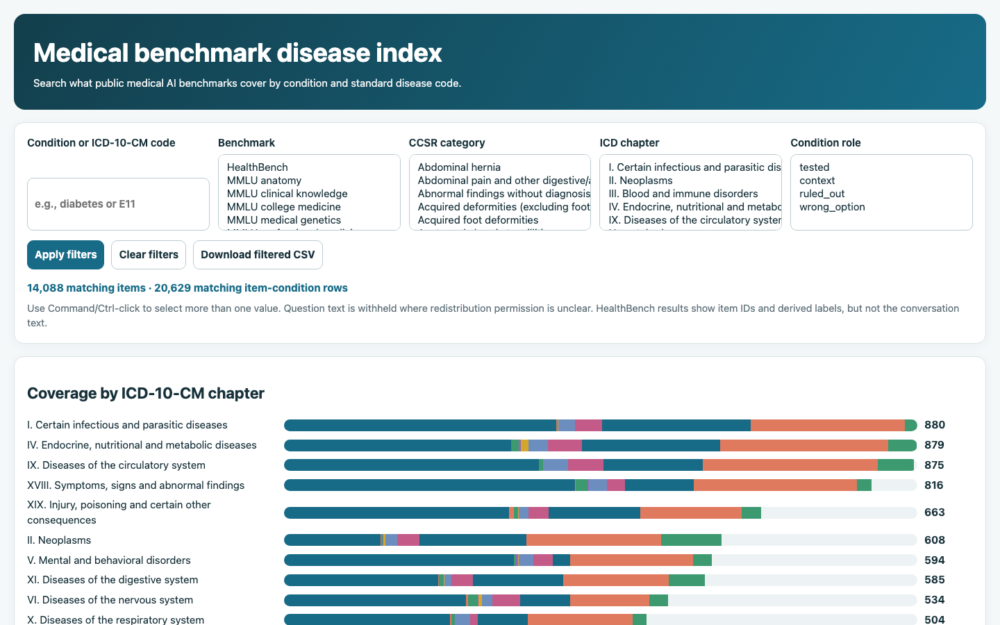
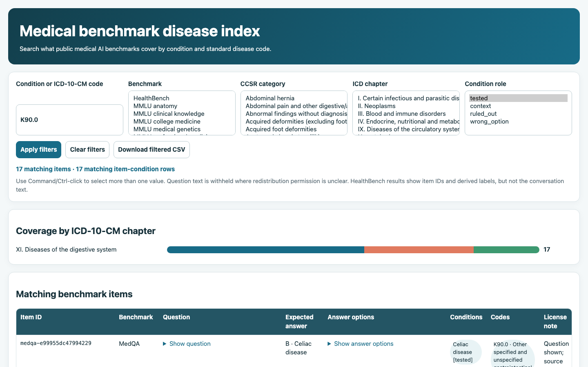
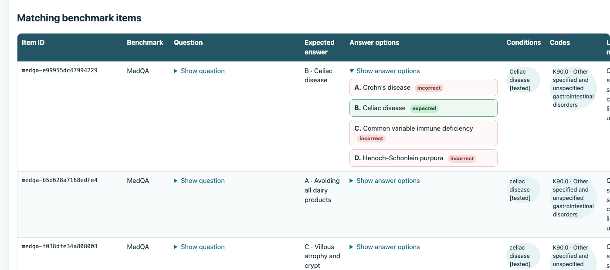
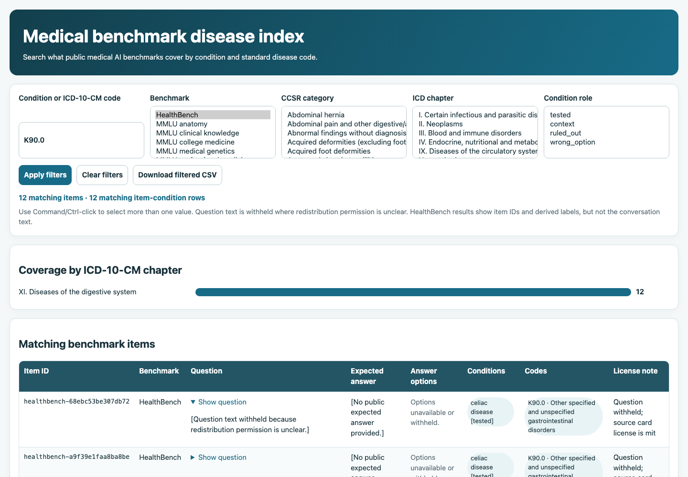

# Medical benchmark disease index

This repository builds a disease-centered index of medical AI benchmark items. It separates three layers: clinical content, reusable evaluation evidence, and a filtered specialty view. The public explorer contains 20,693 items across the original ten sources plus LiveClin 2025 H1.

For the original sources, an AI model assigned question-level and sometimes answer-option-level condition roles, followed by deterministic ICD-10-CM and CCSR lookup. LiveClin is different: its case-level diagnosis and ICD-10 code come from native benchmark fields and are displayed with the role `case_diagnosis`. None of the AI-assigned labels have been independently human-validated.

## Harmonized item schema

Every public item records:

- benchmark and stable item ID;
- clinical task, care setting, user role, and response format;
- evaluation method, reference standard, and evaluation-availability state;
- one or more condition/code rows with code system, code provenance, label provenance, label scope, and condition role;
- expected answer and answer options when the source permits redistribution.

The explorer reports three explicit denominators:

- `n_indexed`: items in the current content slice;
- `n_scored`: items with reusable item-level model-result rows;
- `n_label_validated`: items whose disease labels were independently human-validated.

The current public release has no attached item-level model-result rows and no independent human label-validation rows, so the latter two denominators are zero. Answer keys and rubrics make many items evaluable, but they are not the same as completed model runs.

The benchmark catalog distinguishes fully indexed sources from candidates. MedHELM MIMIC-IV Billing Code, MIMIC-IV-Ext CDS, and MIMIC-IV-Ext MedicalBench are cataloged as candidates only. Their credentialed source data are not republished.

## Rebuild the public explorer data

The rebuild script pins LiveClin to a verified dataset revision, adds its 6,605 MCQs, applies the source harmonization rules, creates an empty-but-typed evaluation-results table, and regenerates the browser JSON:

```bash
python scripts/rebuild_public_explorer.py
```

Configuration is in `config/source_harmonization.json`, `config/benchmark_catalog.json`, and `config/evaluation_result_schema.json`.

## Live tutorial and demo

- **Step-by-step GitHub Pages tutorial:** https://dom-martinelli.github.io/medical-benchmark-disease-index/
- **Browser-only explorer:** https://dom-martinelli.github.io/medical-benchmark-disease-index/demo/
- **Gradio Space:** https://huggingface.co/spaces/dmartinelli/medical-benchmark-disease-index

Prepared examples:

- [Turner syndrome / Q96, one condition-relevant question](https://dom-martinelli.github.io/medical-benchmark-disease-index/demo/?q=Q96&role=tested&item=medmcqa-656a2cf2a35c70ab&expand=question&focus=results)
- [Celiac disease / K90.0, with answer options expanded](https://dom-martinelli.github.io/medical-benchmark-disease-index/demo/?q=K90.0&expand=answers&focus=results)
- [HealthBench K90.0 results](https://dom-martinelli.github.io/medical-benchmark-disease-index/demo/?q=K90.0&source=HealthBench&focus=results)

In this project, the role `tested` means that knowledge of the condition is
needed to answer the item. It does not mean the item was quality-tested or that
a model was evaluated on it.

The separate role `case_diagnosis` means a benchmark supplied a diagnosis or code at the case level. It does not imply that every question in the case directly tests that diagnosis.

## Step-by-step walkthrough

### 1. Open the public explorer

Go to the [browser demo](https://dom-martinelli.github.io/medical-benchmark-disease-index/demo/).
No installation is required.



### 2. Search for a condition or ICD-10-CM code

Type a condition name or code in the first box. For a growth-related example,
use `Q96` for Turner syndrome. Then select `tested` under **Condition role** and
click **Apply filters**.

[Open the prepared Q96 query](https://dom-martinelli.github.io/medical-benchmark-disease-index/demo/?q=Q96&role=tested&focus=results)



The role `tested` means the condition is needed to answer the question. The
other available roles are:

- `context`: the condition is part of the history or setting.
- `ruled_out`: the question explicitly excludes or distinguishes it.
- `wrong_option`: the condition appears in an incorrect answer choice.

### 3. Inspect the expected answer and every option

Open **Show question** or **Show answer options** in a result row. The expected
choice is green, other choices are marked incorrect, and an orange badge shows
when an incorrect choice represents another condition.

[Open a K90.0 example with options expanded](https://dom-martinelli.github.io/medical-benchmark-disease-index/demo/?q=K90.0&expand=answers&focus=results)



### 4. Filter to a benchmark source

Use the **Benchmark** selector to compare sources. For example, this prepared
view shows HealthBench items associated with `K90.0`:

[Open the HealthBench K90.0 view](https://dom-martinelli.github.io/medical-benchmark-disease-index/demo/?q=K90.0&source=HealthBench&focus=results)



HealthBench conversation text is withheld in the public explorer. The displayed
item ID can still be resolved to the original prompt ID and pinned source row.

### 5. Locate a HealthBench source item

Copy the displayed item ID and run the resolver from the repository root:

```bash
python3 scripts/resolve_healthbench_item.py healthbench-68ebc53be307db72
```

The script prints the original `prompt_id`, source row, pinned dataset revision,
raw source URL, and dataset-viewer link. Add `--show-text` only for local review;
do not republish that text in the public explorer.

### 6. Run the prepared explorer locally

```bash
git clone https://github.com/dom-martinelli/medical-benchmark-disease-index.git
cd medical-benchmark-disease-index
python3 -m venv .venv
source .venv/bin/activate
python -m pip install -r requirements.txt
python app.py
```

The included explorer Parquet files are redacted, so the prepared app can run
without downloading or publishing restricted source text.

## Four condition roles, with real examples

These links each open one indexed item. These four roles are model-assigned and
have not been adjudicated by a clinician; the examples show how the categories
are intended to be used. LiveClin's additional `case_diagnosis` role comes from
native benchmark metadata.

| Role | What it means here | Example |
| --- | --- | --- |
| `tested` | Knowledge of the condition is needed to answer the question. | [Turner syndrome (`Q96`): identify the syndrome/karyotype from short stature, webbed neck, and amenorrhea](https://dom-martinelli.github.io/medical-benchmark-disease-index/demo/?q=Q96&role=tested&item=medmcqa-656a2cf2a35c70ab&expand=question&focus=results) |
| `context` | The condition is part of the patient history or setting, but is not what determines the expected answer. | [Hypertension (`I10`): appears in the history of a post-PCI antiplatelet question](https://dom-martinelli.github.io/medical-benchmark-disease-index/demo/?q=I10&role=context&item=medqa-017e7169b2608544&expand=question&focus=results) |
| `ruled_out` | The item explicitly distinguishes the condition from the expected diagnosis. | [Pulmonary embolism (`I26`): an alternative to postoperative atelectasis](https://dom-martinelli.github.io/medical-benchmark-disease-index/demo/?q=I26&role=ruled_out&item=medqa-2be470a615e3789a&expand=answers&focus=results) |
| `wrong_option` | The condition appears in an incorrect answer choice. | [Hypokalemia (`E87.6`): incorrect option D in a salbutamol adverse-effects question](https://dom-martinelli.github.io/medical-benchmark-disease-index/demo/?q=E87.6&role=wrong_option&item=medmcqa-45434ca56d9cd260&expand=answers&focus=results) |

The `wrong_option` view highlights the expected choice in green, marks other
choices incorrect, and adds an orange condition badge to the indexed distractor.

## Quick start

Python 3.10 or newer is recommended.

```bash
python3 -m venv .venv
source .venv/bin/activate
pip install -r requirements.txt
python run.py
```

The first run collects the datasets and labels exactly 50 pilot items. It then stops and writes `data/pilot_labels.md`. After Dominic reviews that table and says go, continue with:

```bash
python run.py --approve-pilot
```

Completed work is checkpointed. Re-running either command skips finished items. Each stage can also be run alone:

```bash
python run.py --stage collect
python run.py --stage label
python run.py --stage code
python run.py --stage validate
python run.py --stage report
```

Use `--limit N` for a smoke test. This limit is recorded in the collection report and must not be used for the paper's final counts.

## What changed on 2026-09-12 (second pass)

- **Stage 3 lookup rebuilt.** The first version used partial fuzzy matching and took the first ICD description containing the condition name, which sent "sepsis" to Salmonella sepsis, "pneumonia" to typhoid pneumonia, and "anaphylaxis" to a personal-history Z code. It now matches in this order: exact code description, the official ICD-10-CM Alphabetic Index (the coder's term-to-code lookup, pinned April 1, 2026 release), description with boilerplate such as "unspecified" removed, whole-name fuzzy match, then an embedding match accepted only at 0.70 or higher. History, screening, and encounter codes are chosen only when the condition name asks for them. Category-level codes such as G30 roll up to CCSR through their billable codes. Regression cases live in `tests/test_code_lookup.py`.
- **Local model context raised to 8,192 tokens, output to 1,024.** The longest HealthBench prompts exceed Ollama's 4,096 default, which silently truncates the start of the prompt, where the instructions are.
- **A malformed model reply no longer stops the full run.** After three attempts the item is recorded as `label_failed`, kept in the data, retried on the next run, and counted in the report. If the Ollama server is unreachable (for example the Mac slept), the item waits up to 30 minutes instead.
- **Explorer hides HealthBench question text** regardless of when `items.parquet` was built.
- **Publishing the Space needs `--deploy`.** A plain `python run.py` never creates a public repository.

Run the full label pass with `caffeinate -i` so the Mac does not sleep mid-run:

```bash
caffeinate -i python run.py --approve-pilot
```

## Model selection and cost safety

The pipeline tries a local Ollama model first, then a Google AI Studio free-tier key from `GOOGLE_API_KEY` or `GEMINI_API_KEY`. It never enables paid Gemini silently. Paid use requires both `--allow-paid` and `GEMINI_PAID=1`, and explicit input/output prices supplied as environment variables. See `python run.py --help`.

If Ollama is installed but not running, the pipeline starts it. If the preferred model is absent, it pulls `qwen2.5:7b-instruct`. This costs no API money but uses local disk space and bandwidth.

The 20-item throughput benchmark, model decision, prompts, counts, token totals, wall time, and cost are appended to `run_log.md`.

## Explorer

After Stage 5 finishes:

```bash
python app.py
```

Stage 5 writes redacted, explorer-only Parquet files that exclude restricted question text. If `HF_TOKEN` is set and you pass `--deploy` (or run `--stage deploy`), the pipeline creates or updates the public Space `<your-user>/medical-benchmark-disease-index`. Set `HF_SPACE_ID=owner/name` to choose a different Space. Without a token, deployment is safely deferred and recorded in the run log.

### Resolve a HealthBench item ID

The public explorer withholds HealthBench conversation text. To map a displayed
ID to the original prompt ID and the pinned source row, run:

```bash
python3 scripts/resolve_healthbench_item.py healthbench-68ebc53be307db72
```

Use `--show-text` only for local inspection. Do not republish that output in the
public explorer.

## Data and licensing

The source dataset card license is recorded on every item. Text from sources with an unknown or absent redistribution license is suppressed in the explorer and filtered downloads. This is a conservative engineering rule, not legal advice. The collection report records exact dataset revisions and any failed source.
